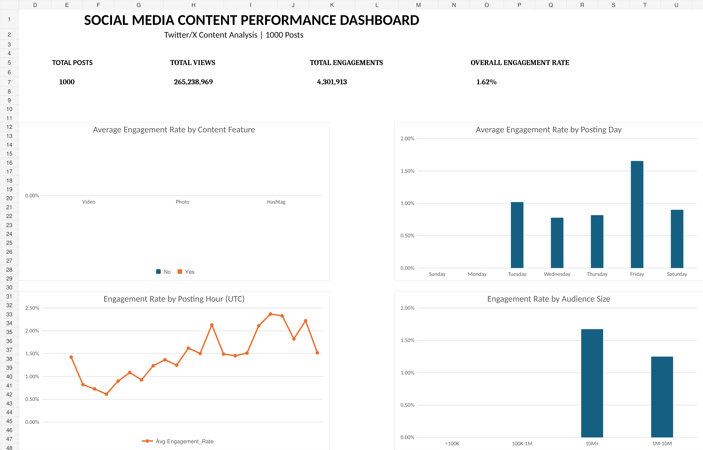

# Social Media Content Performance Analysis

## Overview

This project analyzes 1,000 Twitter/X posts to understand how content characteristics, posting patterns, and audience size are associated with social media engagement.

The project was completed entirely in **Microsoft Excel**, with a focus on transforming raw social media data into actionable marketing insights through data cleaning, feature engineering, exploratory analysis, PivotTables, and an interactive dashboard.

The analysis focuses on a central marketing question:

> **What content characteristics and posting patterns are associated with stronger social media engagement?**

---

## Dashboard



The final Excel dashboard summarizes:

- Total posts
- Total views
- Total engagements
- Overall engagement rate
- Engagement by content feature
- Engagement by posting day
- Engagement by posting hour
- Engagement by audience size
- Interactive video-content filtering

---

## Dataset

The dataset contains **1,000 public Twitter/X posts** collected as part of the Bright Data social media dataset samples.

### Key fields used

- Post description
- Date and time posted
- Views
- Likes
- Replies
- Reposts
- Quotes
- Bookmarks
- Hashtags
- Photos
- Videos
- External links
- Account follower count

### Source

Bright Data — Social Media Dataset Samples

https://github.com/luminati-io/Social-media-dataset-samples

---

## Business Questions

The analysis was designed to answer questions such as:

1. What is the overall engagement level across the dataset?
2. Are posts containing photos associated with higher engagement?
3. Are posts containing hashtags associated with higher engagement?
4. Do video posts outperform non-video posts?
5. Does engagement vary by posting day?
6. Does posting hour appear to influence engagement?
7. Do accounts with larger follower bases consistently achieve higher engagement rates?
8. Are aggregate results being distorted by viral posts or other outliers?

---

## Data Preparation

The original CSV was preserved as a raw-data layer before transformations were applied.

The cleaned dataset included several derived variables to support analysis.

### Total Engagements

Total engagement was defined as:

**Likes + Replies + Reposts + Quotes + Bookmarks**

### Engagement Rate

Engagement efficiency was calculated as:

**Total Engagements / Views**

This allowed posts with different levels of reach to be compared more fairly than using raw engagement totals alone.

### Additional Features

Several analytical dimensions were engineered from the original data:

- `Post_Date`
- `Post_Time`
- `Day_of_Week`
- `Post_Hour`
- `Has_Video`
- `Has_Photo`
- `Has_Hashtag`
- `Has_External_Link`
- `Post_Length`
- `Follower_Bucket`

Follower counts were segmented into:

- <100K
- 100K–1M
- 1M–10M
- 10M+

---

## Key Metrics

| Metric | Result |
|---|---:|
| Total Posts | 1,000 |
| Total Views | 265,238,969 |
| Total Likes | 3,418,999 |
| Total Engagements | 4,301,913 |
| Average Post Engagement Rate | 1.57% |
| Overall Engagement Rate | 1.62% |
| Median Engagement Rate | 1.00% |
| Maximum Engagement Rate | 12.51% |

The difference between the **median engagement rate (1.00%)** and **average engagement rate (1.57%)** indicates that the distribution is influenced by a smaller number of highly engaging posts.

---

## Key Findings

### 1. Photos were associated with higher engagement

Posts containing photos had an average engagement rate of approximately **1.95%**, compared with **1.25%** for posts without photos.

This suggests that visual content may be associated with stronger audience interaction in this sample.

### 2. Hashtags showed a strong engagement association

Posts containing hashtags averaged approximately **1.96% engagement**, compared with **1.06%** for posts without hashtags.

This was one of the largest differences observed among the analyzed content characteristics.

### 3. Video increased reach but not engagement efficiency

Video posts generated higher average views and engagement volume.

However, their average engagement rate was approximately **1.58%**, compared with **1.57%** for non-video posts.

Therefore, video content appeared to increase reach and absolute engagement in this dataset without materially improving engagement efficiency.

### 4. More followers did not consistently mean higher engagement rates

Engagement rate did not increase linearly with follower count.

Average engagement rates by follower segment were approximately:

| Follower Segment | Avg. Engagement Rate |
|---|---:|
| <100K | 1.93% |
| 100K–1M | 1.97% |
| 1M–10M | 1.25% |
| 10M+ | 1.67% |

This demonstrates why follower count alone should not be treated as a measure of content effectiveness.

### 5. Outliers significantly affected aggregate performance

Friday initially appeared to generate exceptionally high reach despite containing only 19 posts.

Further investigation showed that a single post generated approximately **95.1 million views**, accounting for **68.11% of all Friday views**.

This demonstrated the importance of investigating outliers rather than relying only on aggregated metrics.

---

## Data Limitations

### Imbalanced posting-day distribution

The dataset is heavily concentrated on Sunday:

**856 of 1,000 posts (85.6%) were published on Sunday.**

As a result, day-of-week comparisons should be interpreted cautiously and should not be generalized into posting recommendations without a more balanced dataset.

### Outlier influence

Several extremely high-performing posts can substantially influence averages and aggregate metrics.

Median values and post-level engagement rates were therefore considered alongside totals and averages.

### Time-zone limitation

The original timestamps use UTC.

Posting-hour results therefore represent **UTC posting times**, not necessarily the local time of the content creator or audience.

### Correlation does not imply causation

This is an observational dataset.

For example, posts containing hashtags had higher engagement rates in this sample, but this does not establish that hashtags caused the increase.

Content topic, account popularity, audience characteristics, current events, and other variables may also influence performance.

---

## Marketing Recommendations

Based on the analysis:

- Test greater use of **photos and hashtags**, as both were associated with higher engagement rates in this dataset.
- Evaluate **video content using both reach and engagement efficiency**, rather than assuming higher views automatically indicate stronger audience engagement.
- Track **engagement rates alongside absolute metrics** such as likes and views to make comparisons across posts with different reach levels.
- Segment performance by **audience size** rather than assuming accounts with more followers automatically generate more efficient engagement.
- Investigate viral posts and other **outliers** before drawing conclusions from aggregate metrics.
- Collect a more balanced sample across posting days before making decisions about optimal posting schedules.

---

## Excel Skills Demonstrated

This project demonstrates practical use of:

### Data Preparation
- Excel Tables
- Sorting and filtering
- Data validation and inspection
- Calculated columns
- Structured references

### Formulas
- `IF`
- Nested `IF`
- `LEN`
- `LEFT`
- `MID`
- `DATEVALUE`
- `TIMEVALUE`
- `TEXT`
- `HOUR`
- `SUM`
- `AVERAGE`
- `MEDIAN`
- `MAX`
- `COUNTA`

### Analysis
- KPI development
- Engagement-rate analysis
- Segmentation
- Outlier analysis
- Mean vs. median comparison
- PivotTables
- Aggregation using Sum, Count, and Average

### Visualization
- Column charts
- Line charts
- KPI cards
- Slicers
- Interactive Excel dashboard

---

## Workbook Structure

The Excel workbook is organized into separate layers for reproducibility and clarity:

| Worksheet | Purpose |
|---|---|
| `01_Twitter_Raw` | Original imported dataset |
| `02_Twitter_Clean` | Cleaned data and engineered features |
| `03_Twitter_Analysis` | KPI calculations |
| `04_Pivots` | PivotTables and supporting analysis |
| `05_Top_Posts` | Highest-performing posts |
| `06_Dashboard` | Final interactive dashboard |
| `07_Insights` | Findings, limitations, and recommendations |

---

## Tools Used

- **Microsoft Excel**
- Excel Tables
- PivotTables
- PivotCharts
- Slicers
- Excel formulas

---

## Repository Structure

```text
social-media-content-performance-analysis/
│
├── README.md
├── Social_Media_Content_Performance_Analysis.xlsx
├── dashboard.png
└── data/
    └── Twitter-datasets.csv
